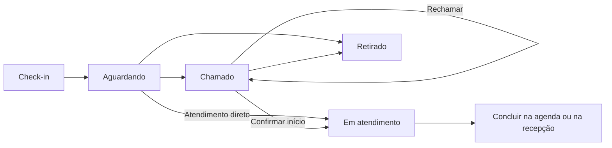

# Módulo de chamada de pacientes

Proposta de MVP para o [cartão #50](https://trello.com/c/U2fo2Yvc). O módulo tem uma fila autenticada para a equipe e um painel de exibição para a TV da recepção. A referência solicitada é o Venda Mais, da Plexter, para configurar a identidade visual do painel, incluindo o logotipo.

O fluxo atual de **Chamar paciente** na recepção já move a consulta para `IN_PROGRESS`. O MVP propõe uma ação própria para o anúncio e mantém a [máquina de estados do agendamento](./appointment-status-machine.md) como referência para iniciar e concluir o atendimento. [Painel de recepção atual](./reception-operations.md)

## Configuração implementada

O gestor publica o primeiro link em **Recepção → Configurar painel de chamada** para habilitar a fila da clínica. A equipe identifica pacientes pelo nome cadastrado. Cada anúncio usa uma sala ou um guichê numerado e ocupa entre 8 e 60 segundos na TV, com padrão de 15 segundos. A identidade usa o logotipo da clínica, quando disponível, e exige contraste mínimo de 4,5:1 entre texto e fundo. [Uso na recepção](./reception-operations.md)

O link leva a `/patient-call#<token>`. A TV consulta `GET /api/v1/patient-call/display` com o token no cabeçalho `X-Patient-Call-Token`. O fragmento evita colocar o token no caminho HTTP. O painel responde com identidade, nome do paciente chamado, destino e expiração da chamada. As operações autenticadas e o formato completo estão no [contrato OpenAPI](../apps/server/openapi.json).

## Fluxo da chegada ao atendimento

1. **Registrar chegada.** O check-in mantém o agendamento em `ARRIVED` e cria uma entrada na fila da clínica. O paciente aguarda a chamada pelo nome.
2. **Chamar.** A equipe escolhe uma entrada elegível e confirma a sala ou o guichê. A TV recebe o nome do paciente e o destino. O agendamento continua em `ARRIVED`.
3. **Rechamar ou retirar.** A equipe pode repetir o último anúncio para aquela entrada ou retirá-la com um motivo. A retirada encerra a entrada na fila. A situação do agendamento é tratada pela ação correspondente da agenda.
4. **Iniciar atendimento.** A equipe confirma o início efetivo. O agendamento vai para `IN_PROGRESS` e a entrada sai da fila ativa. O início pode ocorrer após a chamada ou diretamente, quando o paciente já está na sala.



### Regras da fila

- Uma fila por clínica no MVP, com destino por sala ou guichê. Confirmar se unidades exigem filas próprias já no piloto.
- Ordenar por ordem de chegada. Validar se haverá prioridade manual, quem pode usá-la e se o motivo deve ser obrigatório. A ordenação nunca aparece na TV.
- Manter uma entrada ativa por agendamento. Uma tentativa repetida de check-in ou atualização de página reaproveita a entrada existente.
- A chamada e a reserva da entrada ocorrem de forma atômica. Quando dois operadores tentam chamar a mesma entrada, um confirma e o outro recarrega a fila. Chamadas diferentes são exibidas na ordem em que o servidor as registrou.
- Cancelamento, falta ou conclusão devem retirar a entrada ativa. Chamar e rechamar registram clínica, operador, destino e horário no histórico interno.
- Quem registra chegada continua sujeito a `appointment:checkin`. O MVP deve distinguir permissão de operar fila, de configurar o painel e de iniciar o atendimento. Validar os papéis de secretaria e profissional no piloto.

## Painel público

O endereço compartilhável identifica um único painel. Um gestor ativa, copia, troca ou revoga o endereço. A TV abre esse endereço sem login. A configuração gera um identificador imprevisível por painel, sem nome ou identificador de paciente na URL. A revogação invalida o endereço antigo na próxima consulta.

O servidor retorna identidade visual autorizada, nome do paciente chamado, destino e horário de validade da exibição. Com **Mostrar últimas chamadas**, também retorna nome e destino de até cinco chamadas cujo tempo de exibição terminou nos últimos 30 minutos. A opção vem desativada. A resposta pública omite prontuário, evolução, identificadores internos, status da agenda e a lista de espera.

Proposta de atualização no MVP: a TV consulta o painel a cada poucos segundos. Depois de uma perda de conexão, mostra um estado de reconexão e descarta chamadas expiradas. Em seguida, carrega a última versão válida. O aviso sonoro precisa de uma ação inicial de **Ativar som** quando a política do navegador exigir.

### Esboço da TV

```text
┌──────────────────────────────────────────────┐
│ [Logo da clínica]          Painel de chamada │
│                                              │
│                 Mariana Alves               │
│                     Sala 3                   │
│                                              │
│          Dirija-se ao local indicado         │
│                                              │
│ Últimas chamadas                            │
│ Rafael Costa                        Guichê 2 │
└──────────────────────────────────────────────┘
```

### Esboço da configuração

```text
Painel de chamada
  Título          [ Painel de chamada              ]
  Logotipo        [ Usar logotipo da clínica ▾     ]
  Identidade      [ Cor principal ] [ Cor de fundo ]
  Mensagem        [ Dirija-se ao local indicado    ]
  Aviso sonoro    [ Desativado ▾                    ]
  Últimas chamadas [ Desativado ▾                   ]

  [ Pré-visualizar ]  [ Salvar ]
  Link do painel  [ Copiar ] [ Gerar novo ] [ Desativar ]
```

A clínica já armazena um logotipo em `logoUrl`. [Schema da clínica](../apps/server/prisma/schema.prisma)

A proposta é reaproveitá-lo por padrão e aceitar uma imagem própria do painel caso Produto inclua essa opção. A prévia testa contraste, leitura a distância e ausência de dados reais.

## Cartões de implementação propostos

| Cartão | Dependências | Critérios de aceite |
| --- | --- | --- |
| Configurar identidade e endereço do painel | Aprovação do MVP e definição do papel de gestor | Gestor autorizado salva a identidade, vê a prévia, copia o endereço e consegue revogá-lo. Cada painel pertence a uma clínica. |
| Operar a fila de chamadas | Definição de escopo, ordenação e permissões | Check-in gera uma única entrada. Equipe autorizada chama, rechama e retira. Operações concorrentes mantêm uma única chamada ativa para a entrada. |
| Exibir chamadas na TV | Configuração do painel e eventos da fila | TV abre pelo endereço ativo e exibe nome e destino. Endereço revogado fica indisponível. Reconexão e expiração funcionam. Os testes verificam o isolamento entre clínicas e os campos públicos permitidos. |
| Integrar fila à recepção e à agenda | Operação da fila e teste do painel | O check-in alimenta a fila. Anunciar mantém o agendamento em `ARRIVED`. Iniciar muda para `IN_PROGRESS`. Clínicas ainda sem o módulo usam o fluxo existente. |

Produto valida para o piloto a granularidade da fila, as prioridades, a duração da exibição, a identidade configurável e a divisão de permissões. Após essa validação, os quatro cartões propostos podem ser publicados e priorizados.
